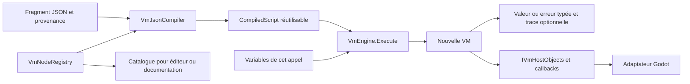

# Audit du dépôt Resolver

> Suivi du 26 novembre 2026 : les constats A1 à A6 ont été traités. Le détail des
> corrections, validations et de la nouvelle revue EGM est dans
> [EGM_CORRECTIONS.md](EGM_CORRECTIONS.md). Le présent audit conserve ci-dessous
> l’état initial et ses références de lignes.

Date : **26 novembre 2026**. Référence examinée : branche `main`, commit `63143a21e30c9a09e53e1ba9790323844dbdb3b1`.

## Avis général

**Le dépôt repose sur une bonne base : l’architecture est cohérente, la documentation utilisateur est riche et les validations exécutées passent. Une refonte générale ne se justifie pas.** La séparation entre moteur indépendant et intégration Godot est réelle, et l’extensibilité des nœuds s’appuie sur le même registre que leur documentation.

Deux écarts ont cependant été reproduits : plusieurs méthodes Godot autorisées par défaut sont inutilisables à cause de leur nom, et les limites de taille ne couvrent pas toutes les valeurs comme le laisse entendre le README. La frontière des permissions sur les objets mérite également une explication explicite avant d’intégrer des mods peu fiables.

| Dimension | Appréciation | Motif principal |
|---|---|---|
| Architecture | Bonne | Cœur indépendant, adaptateur injecté, état d’exécution par appel |
| API et extensibilité | Bonnes | Registre partagé avec le compilateur et le catalogue, anciens handles conservés |
| Documentation utilisateur | Bonne, contrats à préciser | Exemples complets et diagnostics expliqués ; réserves sur les budgets et les permissions |
| Tests | Convaincants sur le périmètre vérifié | 64 contrôles réussis sur les sources et sur le paquet, intégration Godot réussie |
| Construction et distribution | Bonnes | Deux paquets construits, consommateur Godot compilé et exécuté |
| Préparation d’une publication publique | À terminer | Défaut Godot à corriger, licence et métadonnées du dépôt à décider |

Ces appréciations ne sont pas une mesure de couverture exhaustive du code.

## Méthode et périmètre

Revue EGM ciblée avec trois lecteurs indépendants en contexte neuf : architecture, exactitude de la documentation, construction et livraison. Leurs constats ont été recoupés avec le code ; les compilations, tests et reproductions ci-dessous ont été exécutés séparément par l’agent principal. Il s’agit d’une passe d’audit du dépôt existant, pas du cycle complet de revue et de correction d’un document de conception.

Le périmètre couvre le README, le catalogue JSON, les projets MSBuild, le générateur Roslyn, le compilateur, le runtime, les valeurs, les registres, la compatibilité historique, l’adaptateur Godot, l’infrastructure de tests, le packaging et le workflow de publication. Les références de lignes ci-dessous correspondent au commit examiné.

Le graphe `graphify-out/graph.json` et son wiki sont absents de cette copie : la navigation a donc utilisé les fichiers directement. Des références du skill Graphify apparaissaient déjà supprimées ou inaccessibles au début de l’audit ; elles ont été laissées en l’état. Cela décrit l’environnement local et ne démontre pas un défaut du moteur.

Le code du produit n’a pas été corrigé pendant cet audit. Les fichiers de vérification et les sorties de compilation sont dans des emplacements ignorés par Git, principalement `artifacts/audit/`, `bin/`, `obj/` et `.godot/`. Ce rapport est le seul ajout destiné au dépôt.

## Vérifications réellement exécutées

Environnement : Windows, SDK .NET **10.0.301**, Godot **4.7.2 .NET**, version moteur `4.7.2.stable.mono.official.ed1daf0bf`.

| Vérification | Résultat observé |
|---|---|
| `dotnet run --project tests/Resolver.Tests.csproj -c Release` | **64/64 contrôles réussis** |
| `tools/Pack.ps1` avec sortie dans `artifacts/audit/packages` | Les deux paquets `0.1.0` ont été construits |
| Inspection des deux `.nuspec` produits | Le cœur ne déclare aucune dépendance de paquet ; le générateur ne fuit pas chez les consommateurs ; le paquet Godot dépend du cœur |
| Même suite avec `ResolverUsePackage=true`, source locale et cache de paquets séparé | **64/64 contrôles réussis** |
| `dotnet build Resolver.csproj` | Réussite, **0 avertissement et 0 erreur** |
| Restauration puis compilation du consommateur `tests/godot-project` à partir des paquets | Réussite, **0 avertissement et 0 erreur** |
| Import Godot sans fenêtre puis exécution de `tests/godot/smoke.gd` depuis le paquet restauré | **`GDScript smoke checks: PASS`**, code de sortie 0 |
| Export du catalogue par le moteur compilé et comparaison JSON avec `docs/node_catalog.json` | **Identiques**, y compris les métadonnées ; 41 nœuds, 5 types littéraux, 13 types de valeurs |
| Reproductions ciblées des appels Godot et des limites de taille | Les écarts A1 et A2 ci-dessous sont confirmés |

La restauration Godot avec une URL passée par `--source` a rencontré localement `NU1301` : l’URL était transformée en chemin Windows. La restauration a ensuite réussi avec le flux des paquets de l’audit et les dépendances Godot déjà présentes dans le cache local, copiées vers un cache consommateur séparé. La compilation et l’exécution Godot sont donc vérifiées ; une installation Godot entièrement téléchargée à neuf ne l’est pas. La cause de cette transformation d’URL n’a pas été attribuée au dépôt.

Le workflow GitHub Actions a été relu, mais n’a pas été lancé à distance. Aucun paquet n’a été publié.

## Architecture : ce qui fonctionne bien

Le parcours principal reste lisible :



**La frontière Core/Godot est utile et effective.** Le cœur compile sans référence d’assembly Godot, ce que la suite vérifie explicitement. L’adaptateur fournit l’accès aux objets, les conversions et les façades utilisables par GDScript. La distribution de ces façades sous forme de sources permet de respecter les chemins `res://` du projet consommateur ; ce n’est pas une complication gratuite.

Références : `core/Resolver.Core.csproj:12-14`, `Resolver.Godot.props:5-10`, `packaging/build/Darkelle.Resolver.Godot.targets:8-23`, `tests/Program.cs:368-372`.

**L’état d’une exécution est séparé de la compilation.** `VmEngine.Execute` copie la table des variables et crée une VM par appel. Le programme compilé est figé ; les constantes de collection sont copiées avant utilisation. Le README annonce correctement que les collections injectées et les objets hôtes conservent, eux, des sémantiques de référence. L’isolation des tables ne promet donc pas une copie profonde de tout l’environnement hôte.

Références : `src/central/runtime/VmEngine.cs:118-128`, `src/central/runtime/Program.cs:115-134`, `src/central/runtime/VM.cs:193-198`, `README.md:242-245`.

**L’extensibilité et la documentation ont une source commune.** Le registre alimente le compilateur, les contrats d’entrées/sorties et le catalogue exporté. Les définitions sont photographiées, les collisions sont contrôlées et le remplacement d’un nœud invalide les compilations mises en cache tout en préservant les anciens handles. Cette conception limite les divergences entre l’éditeur, la documentation et l’exécution.

Références : `src/central/nodes/VmNodeRegistry.cs:47-86`, `src/central/compiler/VmJsonCompiler.cs:111-112`, `src/central/runtime/VmEngine.cs:40-43,83-87`, tests de registre dans `tests/Program.cs:629-673`.

**Les diagnostics font partie du produit.** Source, chemin JSON, provenance après fusion, opérandes, contexte bytecode et trace sont traités ensemble. Les tests vérifient notamment les branches non visitées, les erreurs après troncature de trace, les mutations de collections et les limites d’instructions. C’est un investissement pertinent pour déboguer des mods.

**La compatibilité historique est délimitée.** `RuleNodeProcessor` conserve les compilateurs historiques explicitement enregistrés et délègue les expressions intégrées au nouveau compilateur. Une vérification dédiée existe. La coexistence de ces chemins ne suffit pas à les qualifier de code inutile.

Références : `src/central/rule_node_system/RuleNodeProcessor.cs:21-56`, `tests/Program.cs:374-380`, `README.md:808-814`.

## Constats à traiter

Priorités : **P1** = correction prioritaire d’un comportement public ; **P2** = contrat ou décision importante avant diffusion plus large ; **P3** = amélioration de maintenance. Les risques conditionnels sont distingués des défauts reproduits.

### A1 — P1 — Plusieurs méthodes Godot autorisées par défaut sont inutilisables

**Défaut reproduit.** Le registre enregistre des noms C# comme `Play`, `Stop`, `IsPlaying`, `Start`, `ApplyImpulse` ou `MoveAndSlide`. `GodotHostObjects.Call` vérifie ensuite le nom exact avec `HasMethod` et le transmet directement à Godot. Les méthodes natives attendent `play`, `stop`, `is_playing`, `start`, etc.

Références : [DefaultExposedMethods.cs](src/central/security/DefaultExposedMethods.cs), lignes 61-63, 82-88 et 102-115 ; [GodotHostObjects.cs](src/godot/GodotHostObjects.cs), lignes 32-37. L’initialisation est active via `VmEngineNode.cs:23` et `Initializer.cs:17`.

Sur un `AnimatedSprite2D` neuf, l’audit a observé :

```text
has_method("is_playing") = true
has_method("IsPlaying") = false
object_call("is_playing") -> HOST_CALL_FAILED : méthode non exposée
object_call("IsPlaying")  -> HOST_CALL_FAILED : méthode introuvable
```

Le README donne déjà la bonne convention (`README.md:763-766`). Le défaut porte sur la liste des autorisations. Le smoke actuel couvre `get_name`, qui fonctionne, mais pas les familles concernées (`tests/godot/smoke.gd:81-85`). Cela explique pourquoi toutes les validations existantes peuvent passer.

**Action proposée :** utiliser les noms natifs, idéalement les constantes `MethodName` du SDK Godot, puis ajouter des vérifications représentatives pour l’animation, les timers et la physique. Contrôler aussi que chaque autorisation par défaut correspond à une méthode réellement disponible sur le type concerné. Le changement peut rester local au registre et aux tests.

### A2 — P2 — Le README étend trop la portée des limites de taille

**Écart de contrat reproduit.** `README.md:722-728` indique que `MaxCollectionItems` et `MaxStringLength` « limitent chaque collection et chaîne ». Les contrôles s’appliquent aux constantes copiées et à plusieurs opérations intégrées, mais une valeur injectée comme variable peut traverser le programme sans subir ces limites.

Références : [VM.cs](src/central/runtime/VM.cs), `LoadVariable` lignes 159-161, appels hôtes lignes 163-183 et réservation des constantes lignes 215-230 ; [README](README.md), ligne 724.

Une expression `{"variable":"value"}` a été exécutée avec les limites abaissées :

| Entrée | Limite | Résultat observé |
|---|---|---|
| Variable chaîne `"abcd"` | `MaxStringLength = 3` | Succès, chaîne de longueur 4 |
| Variable tableau `[1,2,3]` | `MaxCollectionItems = 2` | Succès, tableau de 3 éléments |
| Même chaîne comme constante du script | 3 | `STRING_LIMIT` |
| Même tableau comme constante du script | 2 | `COLLECTION_LIMIT` |

Les limites fonctionnent donc sur les chemins contrôlés ; elles ne forment pas une validation universelle des valeurs hôtes. Les retours de callbacks ne sont pas non plus validés en taille à ces frontières. Le README précise déjà que les allocations internes des callbacks restent hors budget, mais ne décrit pas clairement le passage de valeurs déjà trop grandes.

**Action proposée :** définir explicitement que les budgets portent sur les allocations et opérations contrôlées par la VM, avec la responsabilité de l’hôte pour ses valeurs injectées et retournées. Si une limite universelle est souhaitée, ajouter une validation aux frontières concernées et les tests correspondants. Le choix du contrat doit précéder l’extension du code.

### A3 — P2 — Les capacités accordées aux objets Godot doivent être explicites

**Lacune documentaire et risque d’intégration, pas preuve d’une promesse de confinement violée.** Le README explique le filtrage des méthodes, mais ne précise pas suffisamment que les propriétés et la destruction suivent un autre régime.

`GodotHostObjects.Get` et `Set` acceptent les propriétés présentes dans `GetPropertyList`, sans liste d’autorisation équivalente à celle des méthodes. `Free` appelle directement la destruction de la cible. Le catalogue expose bien les opérations correspondantes.

Références : [GodotHostObjects.cs](src/godot/GodotHostObjects.cs), lignes 18-29 et 42-45 ; `src/central/opcode/list_opcodes/object/ObjectFreeOpcode.cs` ; section `README.md:760-787`.

**Impact :** fournir un objet du jeu à un mod lui accorde des capacités plus larges que quelques appels de méthodes autorisés. Une propriété peut aussi retourner une autre référence utilisable par le script. Une liste de méthodes réduite ne suffit pas à décrire toute la surface accessible.

**Action proposée :** ajouter une courte section « modèle de confiance » : méthodes filtrées, propriétés exposées par l’adaptateur, destruction, callbacks de confiance et contraintes de thread Godot. Pour un jeu exigeant des capacités plus limitées, fournir des objets façades ou un adaptateur restreint. Ce besoin dépend du modèle de mods ; aucune couche de permissions supplémentaire n’est nécessaire par principe.

### A4 — P2 avant publication publique — Licence et métadonnées à décider

**Décision restante, déjà reconnue par le README.** Aucun fichier de licence du projet ni métadonnée de licence n’a été identifié. Les paquets produits ne déclarent pas non plus d’URL de dépôt ; leur élément `repository` contient le type Git et le commit.

Références : [Directory.Build.props](Directory.Build.props), lignes 3-8 ; inspection des `.nuspec` produits ; `README.md:82-83`.

**Impact :** les futurs utilisateurs ne disposent pas d’une autorisation de réutilisation clairement établie, et le lien vers les sources est moins facile à retrouver depuis NuGet. Cela n’empêche pas la compilation locale.

**Action proposée :** choisir une licence avec le propriétaire du projet, puis renseigner la licence et `RepositoryUrl` avant publication publique. L’audit ne choisit pas cette licence à sa place.

### A5 — P3 — La procédure de montée de version oublie le workflow

**Écart vérifié par lecture.** `README.md:79-80` demande de mettre à jour `Directory.Build.props` et `tools/Pack.ps1`. Le workflow garde pourtant sa propre version de développement `0.1.0` à `.github/workflows/nuget.yml:27`. Les tags la remplacent, les validations de branche et les lancements manuels non.

**Impact :** après une montée à `0.2.0` suivant cette procédure, les validations hors tag continueraient à construire des paquets nommés `0.1.0`. La publication depuis un tag conserve sa propre logique correcte.

**Action proposée :** lire la version de développement depuis `Directory.Build.props`, ou au minimum documenter le troisième emplacement. Une source unique est préférable à trois valeurs à synchroniser.

### A6 — P3 — La vérification locale d’un paquet peut réutiliser une ancienne version

**Risque de procédure, pas échec observé pendant cet audit.** Les commandes locales de `README.md:39-44` réemploient le cache NuGet global. Reconstruire une version déjà restaurée, puis refaire un `restore` depuis le flux local, ne garantit pas de remplacer le paquet présent dans ce cache.

La CI évite déjà ce problème pour le cœur avec un cache dédié (`.github/workflows/nuget.yml:38-45`). L’audit a aussi utilisé des caches séparés pour tester ses paquets.

**Action proposée :** reprendre cette méthode dans les instructions locales avec un `NUGET_PACKAGES` propre à la vérification, ou utiliser une nouvelle version de paquet. Le critère de réussite est de consommer les octets du paquet qui vient d’être construit.

## Documentation et maintenance : améliorations proportionnées

Le README de 814 lignes fournit déjà un guide utilisateur substantiel : installation, fragments, provenance, exemples C#/GDScript, catalogue, extensions, erreurs, cache, traces et vérifications. Ses dix liens relatifs ont été vérifiés. Le catalogue versionné correspond exactement à un export frais. Il n’est donc pas justifié de conclure à une documentation globalement absente ou obsolète.

Les ajouts les plus utiles seraient :

- **Une carte d’architecture courte pour les contributeurs**, avec la frontière Core/Godot, le rôle du générateur, les trois points d’extension et la compatibilité historique. Un sommaire faciliterait également la navigation dans le README.
- **Les limites de compilation**, actuellement dans le code : 16 MiB de JSON, profondeur JSON 128 et 100 000 opérations (`LocatedJson.cs:23-26`, `VmJsonCompiler.cs:99`). Préciser également qu’un budget d’instructions VM ne préempte pas un callback natif bloquant.
- **Une politique explicite du registre de permissions**, global au processus (`ExposedMethodRegistry.cs:6-11`). Une modification affecte toutes les instances ; une politique par instance ne devient utile que si le jeu en a besoin.
- **Une frontière de fichiers Godot plus facile à maintenir.** Les exceptions de compilation sont répétées dans `core/Resolver.Core.csproj:12-13`, `Resolver.Godot.props:6-10` et `packaging/Resolver.Godot.csproj:13-17`. Elles concordent aujourd’hui. Déplacer progressivement les fichiers d’adaptateur sous `src/godot` ou partager une liste MSBuild réduirait le risque de divergence lors d’un ajout.
- **Une comparaison du catalogue versionné dans la CI.** La suite contrôle déjà les définitions et la compilation des exemples ; comparer aussi l’export au fichier livré protégerait sa fraîcheur à l’avenir. Aucun décalage actuel n’a été trouvé.

La dernière phrase du README (`README.md:814`) pourrait aussi citer `RegisterNode` et `RegisterCompilerNode` en plus de `RegisterFunction`, pour correspondre aux points d’extension documentés plus haut.

Le lanceur de tests est un exécutable personnalisé, et non un projet de tests standard. Il exécute ses contrôles et retourne bien un échec si l’un d’eux échoue (`tests/Program.cs:779-786`). Cela convient à la CI actuelle ; un découpage par domaine et un rapport de tests standard deviendraient utiles si la suite grossit. Une migration de framework n’est pas une condition de qualité immédiate.

## Livraison et CI : appréciation

La chaîne de livraison est bien pensée pour la taille du projet : tests des sources, construction des paquets, test du cœur empaqueté avec cache isolé, compilation du consommateur Godot puis exécution GDScript. Le job de publication réutilise les artefacts validés au lieu de reconstruire les paquets.

Les permissions GitHub sont limitées à la lecture du contenu ; les identifiants Git ne sont pas conservés par le checkout. Le secret NuGet est utilisé uniquement dans le job de publication, conditionné par un push de tag et rattaché à l’environnement `nuget`. Le téléchargement Godot est accompagné d’une vérification SHA-512.

Références : `.github/workflows/nuget.yml:10-20,33-71,74-96`.

Les actions et le SDK ciblés existent ; leur version n’est pas un défaut identifié. Les références d’actions majeures et le SDK `10.0.x` restent flottants : une reconstruction strictement identique n’est pas démontrée, malgré `Deterministic=true`. Cela ne remet pas en cause les validations fonctionnelles réalisées.

## Ordre de travail recommandé

| Ordre | Action | Critère de réussite |
|---|---|---|
| 1 | Corriger les noms natifs de la liste Godot et étendre le smoke | Appels représentatifs d’animation, timer et physique utilisables avec la configuration par défaut |
| 2 | Clarifier budgets et capacités des objets | Le guide décrit exactement les valeurs contrôlées et les pouvoirs accordés par l’adaptateur |
| 3 | Décider licence et URL du dépôt avant publication publique | Licence choisie et métadonnées présentes dans les paquets |
| 4 | Centraliser la version et isoler les tests locaux de paquets | Une seule version de développement ; vérification du paquet fraîchement construit |
| 5 | Ajouter une carte de contribution et protéger la fraîcheur du catalogue | Un nouveau contributeur sait où intervenir ; la CI détecte un catalogue périmé |
| 6 | Simplifier les listes de fichiers lors d’une prochaine évolution de la frontière Godot | Même frontière en compilation directe et dans le paquet, avec moins de duplication |

Les actions 1 à 4 peuvent être réalisées par petites modifications indépendantes. Les constats ne justifient ni l’abandon de la VM actuelle ni une réécriture de l’architecture.

## Limites de l’audit

Les validations ont été réalisées sur Windows et la CI Linux a été examinée statiquement. La publication réelle, la disponibilité des noms NuGet, les protections de l’environnement GitHub et la conformité juridique d’une future licence restent hors des vérifications exécutées. Aucun benchmark, pourcentage de couverture, fuzzing exhaustif, test prolongé de concurrence ou audit complet de sécurité n’a été réalisé. Les références partagées avec l’hôte et les callbacks de confiance empêchent d’assimiler la VM à un confinement complet de code arbitraire.

Statut des trois revues indépendantes : **terminées**. Statut des compilations et tests listés : **exécutés**, avec les résultats et réserves indiqués ci-dessus. Les corrections proposées restent à appliquer.
